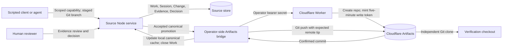

# Source / Workers / Artifacts hybrid

Implemented locally; live Cloudflare deployment remains deferred. The local
contract rehearsal uses real Source services, Worker handlers and Git processes,
but substitutes a local bare repository for the Artifacts service. It cannot
prove Cloudflare availability, Git compatibility, latency or deployment capacity.

## Architecture



Node runs the application, Git subprocesses and review/evidence lifecycle.
Postgres remains the intended hosted store; JSON/SQLite support local use.
Workers provide the authenticated Artifacts control endpoint. Artifacts owns
the remote canonical Git branch for a bound repository. Source's bare repository
holds staged proposals and a local canonical cache.

Contributors receive Source-scoped credentials. They do not receive Artifacts
write tokens or the Worker operator secret. The receive hook rejects direct
updates and deletion of `main`; accepted promotion bypasses that receive path.
Artifacts tokens are repository-wide credentials, not branch-scoped agent
permissions. Giving them to agents would defeat this boundary.

## Reproduce the local proof

From the repository root with Node 22 and Git:

```sh
npm ci
npm run demo:hybrid
node --test tests/artifacts.test.js cloudflare/artifacts-bootstrap/worker.test.js
```

The demo creates temporary state, executes a proposed-content check, records its
evidence, denies agent approval and direct canonical push, accepts as the scripted
maintainer, simulates a lost acknowledgement after a successful push, reconciles
on retry, and checks the commit and content in an independent clone. It prints a
credential-free JSON result and removes the temporary state. Maintainer approval
is scripted; no LLM inference or real human judgment is claimed by this fixture.
The separate `demo:contest` command demonstrates three concurrent clients and
conflict recovery. Neither local rehearsal is genuine cloud footage.

## Operator binding after account setup

This section is a runbook, not evidence that deployment happened. First deploy
[the Worker](../../cloudflare/artifacts-bootstrap/README.md), configure its
`SOURCE_BOOTSTRAP_SECRET`, and verify access to the intended namespace. Provide
the same secret privately to the Source process through a secret manager. Set
`SOURCE_ARTIFACTS_WORKER_URL` to the HTTPS Worker origin, without a path or query.
The Worker and Source must not expose this secret to contributors.

Stop all Source writers while binding. Use a fresh local repository on `main`:

```sh
# SOURCE_DATA and, if applicable, SOURCE_STORE / SOURCE_DATABASE_URL identify
# the intended Source instance. Initialize its org/project before these steps.
node bin/source.js repo create --org O1 --project P1 --name hybrid
# Substitute the repository ID printed above and a unique operator-chosen name.
node bin/source.js repo bind-artifacts --org O1 --project P1 --repo R1 \
  --artifacts-name source-hybrid-entry --create-remote
```

`--create-remote` requires an empty local canonical branch. Creation is never
retried automatically. If creation or binding has an uncertain result, inspect
the remote repository and repeat the same binding **without** `--create-remote`.
Do not choose a new name merely to hide an uncertain previous outcome.

For an existing remote, omit `--create-remote`. An empty local repository imports
its canonical tip; a populated local canonical branch must already equal the
remote. Mismatches require operator inspection. Binding is pinned in both the
Source repository record and the bare repository's `source-artifacts.json`.
Those files contain only non-secret provider/name/remote/branch metadata.
The existing pre-receive hook is never overwritten unless it is this exact guard;
custom `core.hooksPath` configurations are rejected during binding.

Restart Source with the same environment. Contributors push proposal branches
through Source's authenticated Git endpoint, submit Changes, attach evidence,
and obtain a permitted maintainer decision. Promote through the review UI or:

```sh
node bin/source.js canonical update --org O1 --project P1 --change C1
```

A nonzero CLI exit or HTTP 409 means promotion is not complete. Inspect the result;
Work remains accepted until every repository promotion is confirmed. The server
returns a pending result instead of silently redirecting after failed promotion.
The synchronous service method refuses bound repositories.

## Concurrency and recovery

Before pushing, the bridge reads the remote tip and verifies that the accepted
head descends from it and that the proposal base is an ancestor of that tip. It
uses an explicit Git lease for the observed remote ref, then independently reads
that ref again. A concurrent remote update rejects the push rather than being
overwritten. The local cache uses `update-ref` with an expected old value too.

A network failure can happen after the remote accepted the push. Source reports
an unconfirmed result and leaves Work open. Retrying the same accepted Change
recognizes an already-matching remote commit and updates the local cache without
repushing. If another commit wins, a new reviewed revision may be necessary.
Remote promotion, local Git and the Source database do not share a transaction.
Database rollback after a successful push is reconciled by the same retry path.
Multi-repository Changes can partially promote; inspect each repository result.

A missing/corrupt marker or missing guard blocks access rather than falling back
to local-only behavior. Repeat the same operator binding with the service stopped
to repair the guard. Preserve the binding metadata and hooks in backups. A Git
mirror alone does not copy them: rebind each restored/replica checkout before
serving it. Do not enable multiple hybrid writers until the intended topology
and recovery procedures have been tested. Local filesystem administrators and
operator credentials remain trusted; this is not a sandbox against the host.

Git subprocesses and Worker requests have bounded timeouts. Credential headers
are passed in a sanitized subprocess environment, not command arguments or Git
config. Upstream failures are redacted. Responses cannot redirect credentials;
returned remotes must be HTTPS Artifacts URLs and match the pinned repository.

## Evidence required when Cloudflare is available

Use the deployed Worker and actual Artifacts Git remote. Repeat the accepted
Change, stale/conflicting update and interrupted-operation recovery flow, then
clone independently and compare commits/content. Retain non-secret Worker URL,
repository name, entry source commit, accepted commit IDs and verification report.
Re-run the concurrent collaboration rehearsal against the real integration before
claiming that combined cloud behavior. Record genuine footage only after those
checks pass. Account activation, deployment, remote CI, Docker failover, browser
QA, public exposure and manual entry remain separate gates.

API contract checked against Cloudflare's
[Workers binding reference](https://developers.cloudflare.com/artifacts/api/workers-binding/)
on 2026-10-13: `get()` returns a disposable capability, `info()` supplies metadata,
and `createToken()` returns `plaintext` plus `expiresAt`. Live compatibility is
still unverified.
